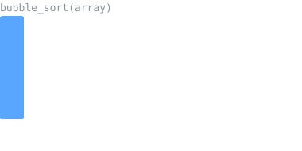

<h1 align="center">João Victor Ferreira Cosmi</h1>

  

  Transição de carreira para a área de TI, com base técnica em montagem e manutenção de computadores. 
  Em busca de estágio ou vaga júnior em engenharia de software.

---

## Sobre mim

- Software Engineer com foco em desenvolvimento back-end e operações corporativas
- Experiência prática com hardware, que me dá uma visão sólida de como o software roda na máquina
- Estudando estruturas de dados, algoritmos de ordenação, modelagem de banco de dados e desenvolvimento web
- Em busca da primeira oportunidade como estagiário ou desenvolvedor júnior

## Stacks

## Projetos em destaque

| Projeto | Descrição | Tecnologias |
| --- | --- | --- |
| **Cadastro de Loja** | Sistema com ID automático, controle de duplicatas, CRUD completo, buscas, ordenações com Bubble Sort e exportação em CSV | C |
| **Ordenação com Arquivos** | Implementação de Bubble, Insertion, Selection, Merge e Quick Sort lendo e gravando dados em arquivos de texto | C |
| **Calculadora** | Calculadora em linha de comando desenvolvida para estudo de lógica e estruturas de controle | C |
| **ReciclaTech** | Site institucional de uma ONG fictícia que recicla computadores para pessoas com deficiência, com 10 páginas | HTML, CSS, JavaScript |
| **Modelagem MER/DER** | Modelagem de dados para um sistema de vendas de semi-joias via liveshop | SQL, MER/DER |

## Algoritmos em ação

  

## Contato

---

<picture>
  <source media="(prefers-color-scheme: dark)" srcset="https://raw.githubusercontent.com/Cosmivctr/Cosmivctr/output/github-snake-dark.svg">
  
</picture>
